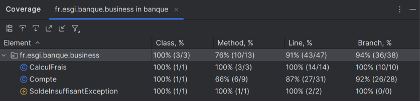

# Rendu

## Identité

**Étudiant** : Benjamin DELAUNAY-GUITTON  
**Campus** : Nantes
----
## Run with coverage

----

## Partie A : tester et corriger l'existant

### Liste des défauts : [CompteTest](./src/test/java/fr/esgi/banque/business/CompteTest.java)

#### Défaut C3 : `crediter()`

La méthode `crediter()` ne rejette pas les montants nuls, négatifs ou `null` avec une `IllegalArgumentException`.

La méthode de test :  
`shouldThrowIllegalArgumentExceptionWhenCreditingInvalidMontant()`

---

#### Défaut C5 : `debiter()`

La méthode `debiter()` ne permet pas d'atteindre exactement la limite du découvert autorisé pour le solde, alors que ce
débit doit être accepté.

La méthode de test :  
`shouldAllowDebitWhenReachingExactOverdraftLimit()`

---

#### Défaut C6 : `estVide()`

La méthode `estVide()` ne renvoie pas `true` lorsque le solde est égal à zéro, quelle que soit son échelle (`0`, `0.0`,
`0.00`, etc.).

La méthode de test :  
`shouldReturnTrueWhenBalanceIsZeroRegardlessOfScale()`
----

### Liste des défauts : [CalculFraisTest](./src/test/java/fr/esgi/banque/business/CalculFraisTest.java)

#### Défaut F3 : `fraisMensuels()`

La méthode `fraisMensuels()` renvoie `0` euro alors que le titulaire a 26 ans.

La méthode de test :  
`shouldReturnMonthlyAccountFeesWhenTitularIs26YearsOld()`
----

#### Défaut F4 : `fraisMensuels()`

La méthode `fraisMensuels()` renvoie `2.00` euros au lieu de `0.00` euro quand le solde moyen atteint 1 000 euros ou
plus.

La méthode de test :  
`shouldReturnZeroFeesWhenAverageBalanceIsAtLeast1000Euros()`
----

#### Défaut F5 : `fraisMensuels()`

La méthode `fraisMensuels()` renvoie `0.00` euro au lieu de `5.00` euros alors que le titulaire détient une carte
premium et que les frais de tenue de compte sont offerts.

La méthode de test :

- Avant refactoring : `shouldChargeFiveEurosForPremiumCardWhenAccountFeesAreFree()`
- Après refactoring :`shouldAlwaysChargeFiveEurosForPremiumCard()`

----
## Partie B : service de virement en TDD

**Non réalisée.**